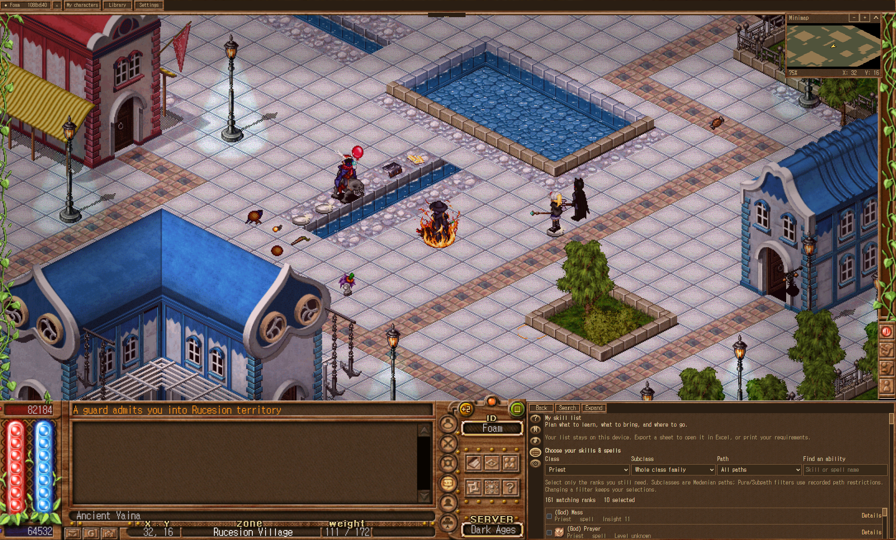

# Foam DA

A Windows companion and offline reference library for Dark Ages. Foam DA combines an expanded game view, local reference search, maps, character switching, hotkeys, skill planning, and screenshots in one desktop host.

## Download and demo

[**Download the Windows installer**](https://github.com/bradmdesign/Foam-DA-public/releases/latest) · [**View the screenshot demo**](docs/demo/README.md)

Run the Windows installer and choose a writable folder. The installer includes the complete offline Library, search, icons, local runtime, Microsoft WebView2 prerequisite and signed automatic updater. You do not need Python, Node, Git, a GitHub account or the .NET SDK. Supported 64-bit Windows 10/11 and a separately installed Dark Ages 7.41 client are required.

On first launch, choose your installed Dark Ages folder. The full game, personal profiles, saved accounts and signing secrets are excluded from downloads. The installer release identifies its exact source commit and includes a signed per-file inventory; it is built from this repository's source. [Installer details](installer/README.md).



## Build and run

Building from source requires Windows, Node.js 24 or newer, Python 3.11 or newer, the .NET Framework 4.x compiler, and Microsoft Edge WebView2 Runtime. Install Dark Ages separately. A packaged Lite build needs the installed game and WebView2; it does not need Python or the compiler.

From this folder, run:

```powershell
powershell -NoProfile -ExecutionPolicy Bypass -File .\Build.ps1
```

This installs build dependencies, generates the compact viewport recipes and theme, builds the offline library, and compiles `prototype/widescreen/Foam-DA.exe`. It does not populate a full `runtime` copy. The first build needs internet access for dependencies; normal reference browsing uses local files.


To select a different game installation:

```powershell
powershell -NoProfile -ExecutionPolicy Bypass -File .\Build.ps1 -GamePath 'D:\Games\Dark Ages'
```

Double-click **Open Foam DA.cmd** after building. For the reference website alone, run `npm run preview` in `site` and open http://127.0.0.1:4173/.

## Use an existing Dark Ages installation

On first launch, select the installed game folder containing **Darkages.exe**. Foam DA checks that the executable and UI archive match the supported 7.41 version and remembers only the folder path. Use **Settings → Dark Ages folder…** to change it later. Cancelling the picker keeps the Library available.

The download contains about **1.7 MB of preparation recipes** for all three viewport sizes. Foam DA reconstructs its modified executable and UI archive locally from the installed originals, checks the resulting hashes, and caches those files under `prototype/widescreen/build/prepared-profiles`. The original installation remains unchanged.

Game tabs still need private working folders. Required assets are copied directly from the selected installation into `build/sessions`, keeping character writes separate. These local copies need disk space, but are never downloaded or distributed. No credentials, character folders, or personal preferences are copied from the selected game folder.

## Make a small download

After building the offline Library, run `powershell -NoProfile -ExecutionPolicy Bypass -File .\Package.ps1`. The resulting `releases/Foam-DA-Lite.zip` includes the host, local Library, Node runtime and compact preparation recipes. The package uses an explicit allowlist: it excludes `runtime`, full prepared game profiles, sessions, screenshots, character data and browser profiles. Do not zip the entire working folder, which can contain development dependencies and local game caches.

For a small update to an **existing Foam DA installation**, use `Package.ps1 -HostUpdate`. Extract that update beside the existing `Foam-DA.exe`; it retains the existing Library and its server configuration. This update is not a complete standalone Library package.

## Automatic updates

Foam DA checks for signed updates automatically. A pending app update must be installed before the host opens. If the update source is unreachable and no update is pending, the installed app remains available offline. Library content updates independently, and running game sessions stay open during a host replacement. See [publisher instructions](publisher/README.md) for publishing records and app versions.

Resize the host to suit your display, including ultrawide, 1920 × 1080, and smaller windows. The game view scales within the host while the original controls and bottom-right Library remain available.

## Source layout

- `prototype/widescreen/`: C# desktop host, rendering, maps, local preferences, client preparation, and checks.
- `site/`: React and TypeScript reference website, normalized content, artwork, search, calculators, and content processing scripts.
- `requirements.txt`: Python build dependencies.
- `THIRD-PARTY-NOTICES.txt`: dependency and reference acknowledgements.

Game executables, game archives, account data, saved profiles, and release signing material are not part of the source package. Theme assets are generated from your installed client. Older local profile identifiers remain for compatibility.

## Checks

```powershell
cd site
npm run typecheck
npm test
npm run content:validate
cd ..\prototype\widescreen
.\Foam-DA.exe --host-checks
.\Foam-DA.exe --minimap-repaint-checks
.\Foam-DA.exe --macro-scheduling-checks
python -m unittest test_prototype test_popup_centering test_endpoint_patch
python -m unittest test_client_patches
.\Foam-DA.exe --client-install-checks
```

The Python client checks require the supported installed game client. The reference snapshot has incomplete coverage; unavailable facts and unresolved source differences remain marked in the data. The expanded view remains dependent on client compatibility and information supplied by the game server.

## Shout-outs and credits

Huge thanks to **Silo**, **vamistle**, **Vorlof**, and **Biomagus**, and to everyone who has shared tools, research, and knowledge with the Dark Ages community. Their work helped make production possible.

Additional thanks to:

- **Erik / Silo (Eric W. Rogers)** for SleepHunter reference material and public Dark Ages client research.
- **Vorlof** for community reference information and catalogs.
- **Russell / Sostratos** for the DA-Items archive.
- **Wanderlust contributors** and **DA-Wizard contributors** for reference information used to compare game facts.
- The maintainers of **React**, **TypeScript**, **Vinext**, **Vite**, **Pagefind**, **WebView2**, **Pillow**, **fontTools**, **pefile**, and the other dependencies used by this project.

These acknowledgements do not imply endorsement. Reference provenance remains with the content records. Required license notices are retained in `THIRD-PARTY-NOTICES.txt` and the included vendor license.

Dark Ages and its game artwork belong to their respective owners, including KRU Interactive. This is an independent community project. No license to third-party game assets is granted by this repository.

Measured package checks are recorded in `VERIFICATION.md`.
