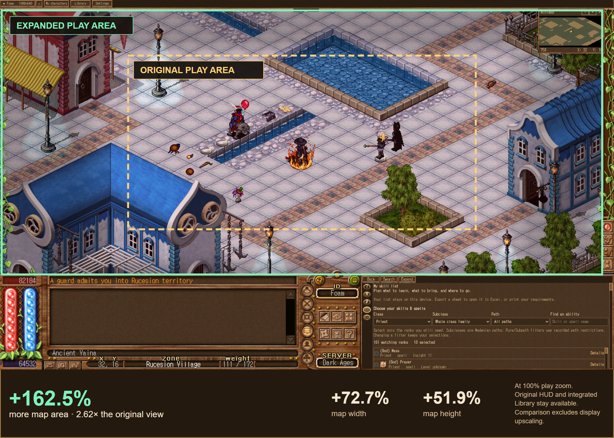
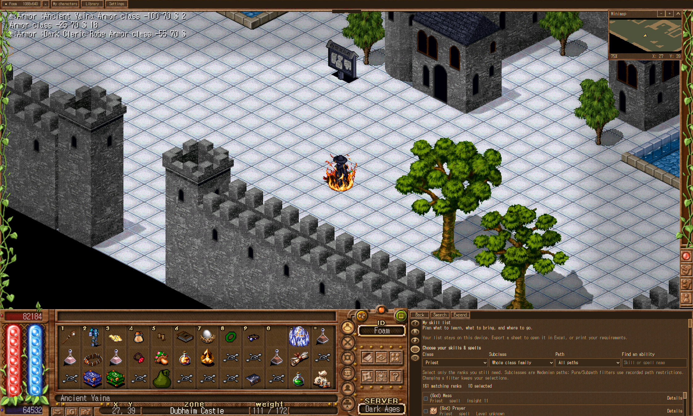
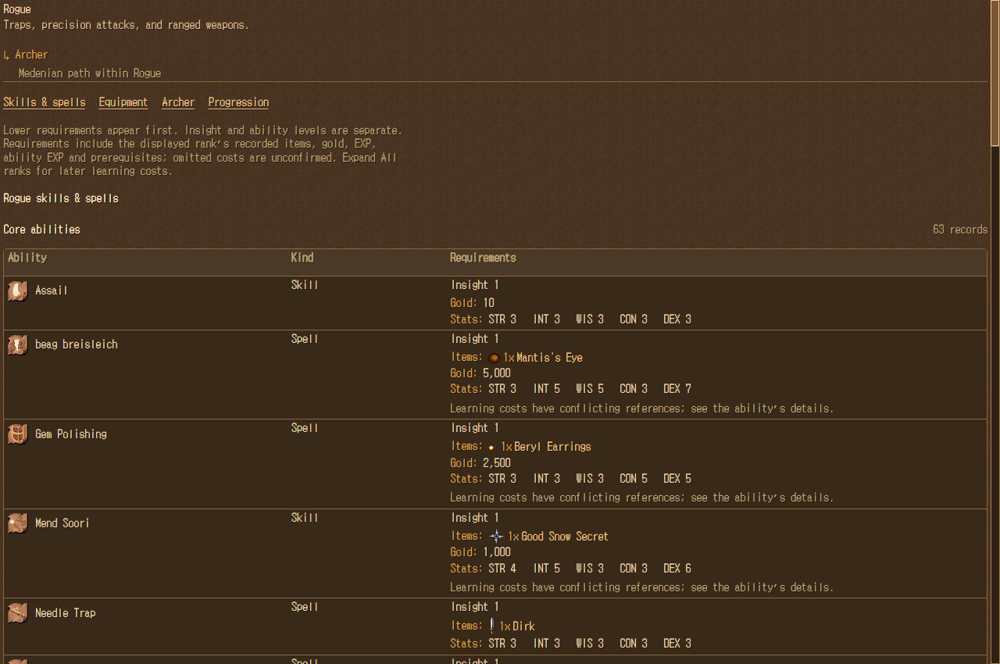

# Foam DA demo

[Download the Windows installer](https://github.com/bradmdesign/Foam-DA-public/releases/latest) · [Project source](../../README.md)

**The EXE is unsigned**, so Windows may warn that it is from an unknown publisher. If you prefer, [download and extract the source, then follow the build steps](../../README.md#build-and-run).

## Expanded game canvas

Choose a window size that suits your display, including ultrawide, 1920 × 1080, and smaller windows. The game view scales inside the host, with the original controls and the Library available together.

**162.5% more map area in the pictured layout.** Gold shows the original view; green shows the expanded view.

## No more alt-tabs!

Nearly every piece of Dark Ages information you would otherwise look up on a website is now right in your client. Search quests, skills, items, spells, and maps in the lightning-fast bottom-right Library. Check requirements, item costs, experience, ability points, icons, sprites, and related records while you play—or open the Library on its own.

## Built-in macros and hotkeys

Keep skill training and key combinations in the same client, reducing the need for extra programs. The Macro panel lets you choose skills or spells to train, or use Simple mode to repeat a key sequence at your chosen interval. Enable Assail to press Space every half-second; macros can continue in other game tabs while you do something else.

The Hotkeys panel turns shortcuts such as **Shift+1** or **Alt+2** into a sequence of keypresses, including timed pauses. For example, `s1234 space (pause:500) 5 6` opens the skill panel, presses 1–4 and Space, waits half a second, then presses 5 and 6. Shortcuts run with the game focused and chat or dialogue closed.

## Automatic updates

Includes an auto-updater.

Install the separately obtained Dark Ages 7.41 client, run the Foam DA installer, choose that game folder, then use **Launch new tab**. The installer includes the offline Library, its local runtime and updater. It contains no full Dark Ages game or saved accounts.
