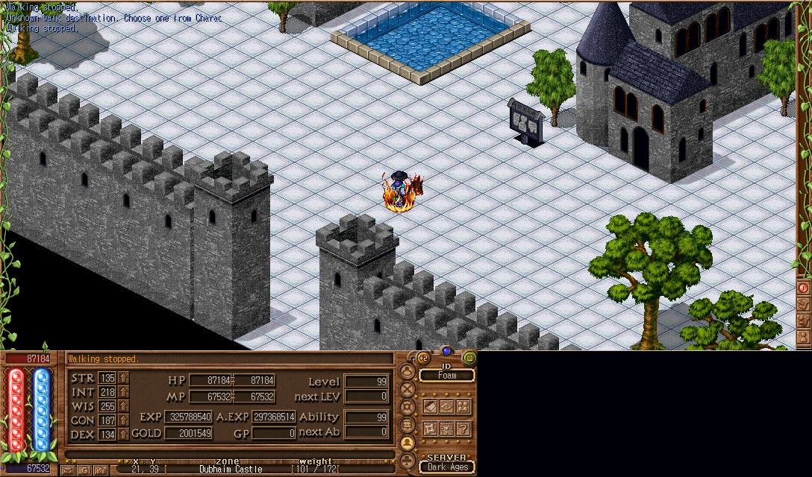

# Foam DA demo

[Download the Windows installer](https://github.com/bradmdesign/Foam-DA-public/releases/latest) · [Project source](../../README.md)

## Expanded game canvas

An actual 1088 × 640 game frame captured during development. The original bottom controls remain available; the host places its Library and tools in the unused corner. Server visibility limits still apply.

## Local reference Library

The built Library using the same compact skin as the game's companion panel. Records include icons, learning requirements, costs, related records and search. It can also open separately while no game is running.

## Automatic updates

The actual native settings screen. Library records and optional sponsored messages update separately; app replacement asks for a host restart and reattaches running games.

Install the separately obtained Dark Ages 7.41 client, run the Foam DA installer, choose that game folder, then use **Launch new tab**. The installer includes the offline Library, its local runtime and updater. It contains no full Dark Ages game or saved accounts.
