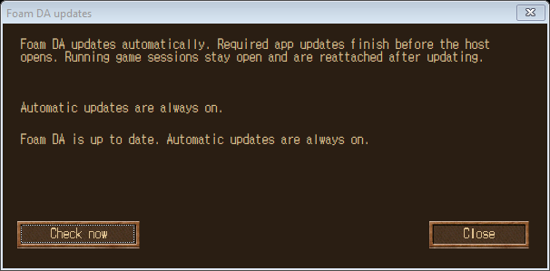

# Foam DA demo

[Download the Windows installer](https://github.com/bradmdesign/Foam-DA-public/releases/latest) · [Project source](../../README.md)

## Expanded game canvas

Choose a window size that suits your display, including ultrawide, 1920 × 1080, and smaller windows. The game view scales inside the host, with the original controls and the Library available together.

In this example, the play area is **162.5% larger**: **72.7% wider** and **51.9% taller**. The gold outline shows the original view; green shows the expanded view. The original HUD and Library remain available.

How the percentages are calculated

The native full-HUD MAP control grows from 616 × 308 to 1064 × 468 logical pixels at 100% play zoom. Area gain = `(1064 × 468 ÷ (616 × 308) − 1) × 100 = 162.46%`. These percentages measure additional rendered map space, excluding display scaling; server visibility limits still apply. Other chosen layouts have different gains.

## Lightning-fast Dark Ages UI

A lightning-fast UI for Dark Ages quests, skills, items, spells, and maps. Find requirements, costs, icons, sprites, and related records in the bottom-right panel—or open the Library on its own.

## Automatic updates

Updates run automatically. A pending app update must finish before the host opens. Library records update independently, and the host reattaches running games after updating. Offline use remains available when no update is pending.

Install the separately obtained Dark Ages 7.41 client, run the Foam DA installer, choose that game folder, then use **Launch new tab**. The installer includes the offline Library, its local runtime and updater. It contains no full Dark Ages game or saved accounts.
